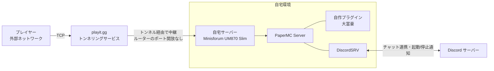

# Minecraft マルチプレイサーバー 構築・運用記録

自宅のミニPCをサーバー機にして、友人最大20名が遊ぶ Minecraft（PaperMC）サーバーを2026年8月から運用しています。

「とりあえず動けばいい」ではなく、次の3点を意識して運用してきました。

- **自宅ネットワークを危険にさらさずに外部公開する**
- **限られたマシンリソースを、ほかの用途と両立させながら割り当てる**
- **トラブルが起きても、すぐ元に戻せる状態を保つ**

> [!NOTE]
> 自作プラグインは生成AIを活用して開発しています。私は仕様の設計、AIへの指示と出力内容の確認、実機でのテスト、不具合の切り分けを担当しました。

---

## 運用の概要

| 項目 | 内容 |
| --- | --- |
| 運用期間 | 2026月〜現在 |
| 利用者 | 友人5名（同時接続は最大20名） |
| 稼働形態 | 常時稼働 |
| 導入プラグイン数 | 5個（自作1つを含む） |

---

## システム構成

### 環境

| 項目 | 内容 |
| --- | --- |
| サーバー機 | Minisforum UM870 Slim（Ryzen 7 8745H / メモリ 32GB） |
| OS | 【Windows 11 / Ubuntu 24.04 など】 |
| Java | 【Java 21 など】 |
| サーバーソフト | PaperMC 26.3（Minecraft バージョン26.3） |
| 外部公開 | playit.gg |
| 外部連携 | DiscordSRV |
| 自作プラグイン | [Minecraft-Daifugo-Plugin](https://github.com/sobaline/Minecraft-Daifugo-Plugin)（トランプの大富豪をゲーム内で遊べるプラグイン） |

---

## 設計で工夫したこと

### 1. ポート開放をせずに外部公開する

自宅ルーターのポートを開けると、自宅のグローバルIPアドレスが利用者に知られるうえ、インターネットから自宅のマシンへ直接アクセスできる入口ができてしまいます。
そこでトンネリングサービスの playit.gg を使い、**ルーターの設定を変えずに外部から接続できる構成**にしました。プレイヤーに見えるのは playit.gg のアドレスだけで、自宅のIPアドレスは公開されません。

ただし、トンネルを使っても「誰でも接続できる入口」があることに変わりはありません。そのためサーバー側でも次の対策をしています。

- 【ホワイトリストを有効にし、登録した友人だけが入れるようにする】
- 【`online-mode=true` のまま運用し、正規アカウント以外の接続を防ぐ】
- 【OP権限は管理者（自分）だけに限定する】

### 2. メモリ割り当ての調整

サーバー機は 32GB のメモリを積んでいますが、【OSやほかの作業用アプリ】 も同じマシンで動かしています。
そこで Minecraft サーバー（Java）に割り当てるメモリを **【○】GB**（`-Xms【○】G -Xmx【○】G`）とし、ほかの処理に 【○】GB 程度の余裕を残しました。

- 最小値と最大値を同じ値にして、稼働中にメモリ確保をやり直す負荷を避けています
- 【割り当てすぎるとガベージコレクション（不要メモリの回収）で一時的に止まりやすくなるため、大きくしすぎないようにしました】
- 【調整前後で、プレイ中のカクつきが ○○ から ○○ に改善した、など】

### 3. 設定ファイルの管理

プラグインの設定や権限は YAML ファイルで管理しています。
変更するときは【変更前のファイルをコピーして残す / 変更内容をメモに残す】ようにし、何をいつ変えたかを後から追えるようにしています。

### 4. バックアップと切り戻し

プラグインの追加やバージョンアップの前には、必ず次のバックアップを取っています。

- ワールドデータ（`world` / `world_nether` / `world_the_end`）
- `plugins` フォルダ（設定ファイルを含む）

バックアップは 【サーバーを停止してから手動でコピー / スクリプトで日付つきフォルダに保存】 しています。
【実際にバックアップから復元できることを、○○のタイミングで確認しました】

---

## トラブル対応の記録

### 事例1：プラグイン導入後、特定の操作でエラーが出る

| 項目 | 内容 |
| --- | --- |
| 発生したこと | ハッピーガスト高速化プラグインを導入したあと、実際に起動をすると低速設定でもサーバーの負荷が増え、スタックした |
| 調べたこと | コンソールのエラーログを確認し、エラーメッセージに出ていたプラグイン名から原因の候補を絞り込んだ。プラグインを外して再起動し、エラーが起きるかを確かめた |
| 原因 | 速度制御の処理がサーバーのメインスレッドに過剰な負荷をかけており、低速設定であっても処理が追いつかなくなっていた |
| 対応 | プラグインを使わない方向性にした |
| 再発防止 | 導入前に、バックアップをとっておき、削除しやすいようにする |

### 事例2：自作プラグインで、複数人のときだけ起きる不具合

| 項目 | 内容 |
| --- | --- |
| 発生したこと | 1人での動作確認では問題なかったが、友人にテストプレイへ協力してもらい複数人で遊んだ際、試合中の途中退出・再接続時やターン切り替え時に、手札やUIのエンティティが残留したり、進行がズレたりする不具合が発生した |
| 調べたこと | 友人に協力してもらいながら「誰が・どのタイミングで・何をしたか」をログと画面で確認し、再現条件（途中退出・再接続や、複数人が同時に操作したタイミングなど）を切り分けた |
| 原因 | プレイヤーの状態管理が切断・再接続を十分に想定しておらず、退出時やゲーム終了時のエンティティ（カード・UI）のクリーンアップ処理や、ターン判定の整合性に漏れがあった |
| 対応 | 再現手順と期待する挙動を整理して生成AIに修正を依頼し、UUID（アカウントごとの固有ID）ベースのプレイヤー管理、切断・再接続時の状態復帰、および終了時の確実なエンティティ削除処理を組み込んだ。修正後、再度友人に協力してもらい複数人環境で再現しないことを確認した |
| 学んだこと | 開発者1人のテストでは気づけない不具合（複数人操作の競合や途中離脱、UIの押しやすさなど）が多いと実感した。周囲の協力を得て実環境に近い条件で検証し、異常系のテストパターンを事前に洗い出す重要性を学んだ |

---

## この経験から学んだこと

- **安全面は「仕組み」と「設定」の両方で考える**：トンネルで入口を隠すだけでなく、ホワイトリストや権限でも守る必要がある
- **元に戻せる状態があると、変更に挑戦できる**：バックアップを取る習慣があったので、新しいプラグインを試すことをためらわずに済んだ
- **不具合は「再現手順を言葉にする」ことが解決の近道**：原因の切り分けや、AIへの的確な修正依頼につながった

## 今後やりたいこと

- 【バックアップの自動化（定期実行）】
- 【サーバーの負荷（TPS・メモリ使用量）の監視と、異常時の Discord 通知】
- 【設定ファイルを Git で管理し、変更履歴を残す】
